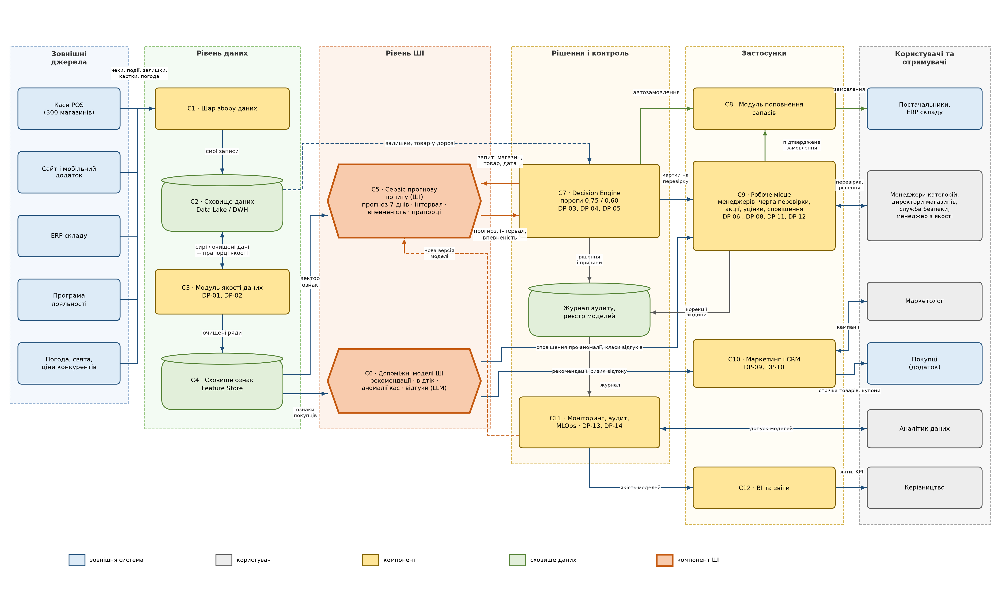
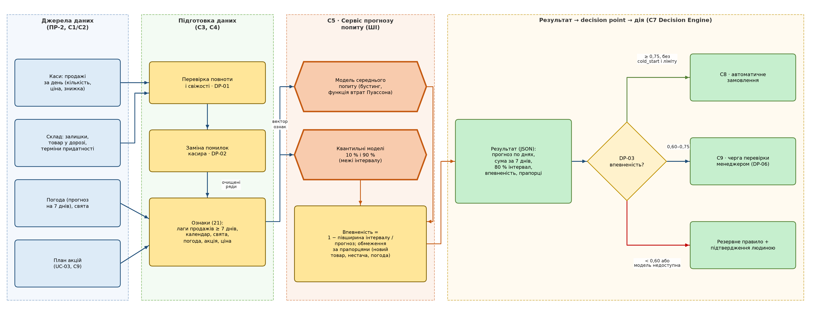
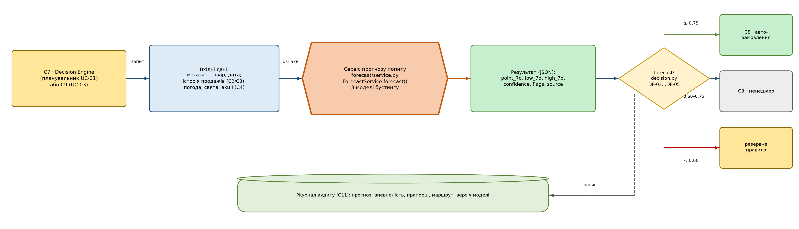

# RetailBigData — прогноз попиту з контролем людини для мережі супермаркетів

Навчальний проєкт з дисципліни «Проектування інформаційних систем та технологія штучного інтелекту».
Автор: Стукалов Нікіта Олександрович, група Б2F201ДОН23, ПВНЗ «Європейський університет», 2026.

Проєкт описує складну систему аналізу великих даних мережі супермаркетів і реалізує її головний компонент
штучного інтелекту — сервіс прогнозу попиту — разом із правилами, які вирішують, коли прогнозу можна довіряти
автоматично, а коли рішення має ухвалити людина.

## Problem

Мережа з ≈300 магазинів і ≈40 тис. товарів щотижня вирішує, скільки кожного товару завезти в кожен магазин.
Дані розкидані по касах, складу, сайту і програмі лояльності. Ручний розрахунок неможливий, а правило «як минулого
тижня» не враховує свята, погоду й акції. Наслідки — списання швидкопсувних товарів, порожні полиці та запізнілі рішення.

## Users

- **Менеджери категорій і закупівель** — перевіряють і підтверджують замовлення, які система не може виконати автоматично.
- **Директори магазинів** — уцінки товарів з близьким терміном, локальні обставини.
- **Маркетологи** — планують акції з оцінкою ефекту, кампанії утримання.
- **Служба безпеки, менеджер з якості** — сповіщення про аномалії на касах і скарги.
- **Аналітики даних** — навчання, перевірка і допуск моделей.
- **Керівництво** — показники мережі та якості прогнозів.
- **Покупці** — опосередковано: персональні рекомендації і купони.

## Solution

1. Дані з кас, складу, сайту, програми лояльності і зовнішніх сервісів збираються в сховище, очищаються
   (помилки касира, дні нестачі товару, пропуски погоди) і перетворюються на ознаки.
2. **Сервіс прогнозу попиту** для пари «магазин × товар» дає прогноз на 7 днів, 80 % інтервал, впевненість і
   прапорці якості даних.
3. **Decision Engine** застосовує правила human-in-the-loop:
   - впевненість **≥ 0,75**, немає прапорця «новий товар», замовлення в межах ліміту → **автоматичне замовлення**;
   - **0,60–0,75** (нестача товару в історії, різка зміна погоди, температура поза досвідом моделі) або перевищено ліміт (3 × середнього) → **перевірка менеджером**;
   - **< 0,60**, новий товар (впевненість ≤ 0,40) або модель недоступна → **прогноз відхиляється**, працює
     резервне правило (середнє за 28 днів × 7), рішення за менеджером.
4. Кожне рішення записується в журнал аудиту; корекції менеджерів використовуються для контролю якості моделі.

Повний опис сценаріїв і decision points: [docs/use_cases_and_decisions.md](docs/use_cases_and_decisions.md).

## Architecture



| Компонент | Роль |
|---|---|
| C1 Шар збору даних | приймає потоки з кас, сайту, ERP, програми лояльності, сервісу погоди |
| C2 Сховище даних | сирі й очищені дані, історія |
| C3 Модуль якості даних | DP-01 повнота і свіжість, DP-02 помилки касира |
| C4 Сховище ознак | однакові ознаки для навчання і прогнозу |
| **C5 Сервіс прогнозу попиту (ШІ)** | прогноз на 7 днів, інтервал, впевненість, прапорці |
| C6 Допоміжні моделі ШІ | рекомендації, відтік, аномалії кас, відгуки |
| C7 Decision Engine | DP-03 маршрут, DP-04 кількість, DP-05 ліміт |
| C8 Модуль поповнення | замовлення постачальникам і в ERP |
| C9 Робоче місце менеджерів | черга перевірки (DP-06), акції, уцінки, сповіщення |
| C10 Маркетинг і CRM | рекомендації і купони |
| C11 Моніторинг, аудит, MLOps | допуск моделей (DP-13), контроль дрейфу (DP-14) |
| C12 BI та звіти | показники для керівництва |

## AI component

- **Задача:** прогнозування попиту (регресія на часових рядах) на 7 днів уперед.
- **Вхід:** історія продажів (лаги 7–28 днів, ковзні середні), календар і свята, прогноз погоди, план акцій і ціна,
  категорія і термін придатності, ознака нестачі товару.
- **Модель:** `HistGradientBoostingRegressor` (scikit-learn) — середній попит з функцією втрат Пуассона і дві
  квантильні моделі (10 % і 90 %) для інтервалу; 21 ознака.
- **Впевненість:** 1 − півширина тижневого інтервалу / прогноз, обмежена прапорцями: `cold_start` (≤ 0,40),
  `censored_demand` (≤ 0,70), `weather_shift` — різка зміна погоди > 8 °C (≤ 0,70), `out_of_range` — температура поза досвідом моделі (≤ 0,60), `outlier_in_history` (−0,10),
  `weather_imputed` (−0,05).
- **Вихід:** JSON `{daily, point_7d, low_7d, high_7d, confidence, flags, source}` для Decision Engine.



## Prototype

Код — у папці [`prototype/`](prototype): консольний інтерфейс, ноутбук `prototype.ipynb` з виконаними комірками, тести.
Набір даних сформовано генератором (відтворюваний, seed 2026): 6 магазинів, 26 товарів, 730 днів, 105 492 записи
продажів із закладеними проблемами якості (42 помилки касира, 1290 днів нестачі, 18 пропусків температури).

```bash
python3 -m venv .venv && source .venv/bin/activate
pip install -r prototype/requirements.txt
cd prototype
python -m forecast.cli generate
python -m forecast.cli train
python -m forecast.cli forecast --store Київ-017 --sku MILK-1L --date 2026-10-24
python -m forecast.cli scenarios
python -m forecast.cli evaluate
python -m forecast.cli backtest     # ≈3 хв: 2484 тижневих прогнози
python -m unittest discover -s tests -v
```



## Results

Навчання — дані до 30.06.2026, перевірка — 17 тижнів липня–жовтня 2026 (2484 тижневі прогнози, 156 пар «магазин × товар»).

| Показник | Значення |
|---|---|
| WAPE за тиждень відносно фактичних продажів | 14,3 % |
| WAPE за тиждень відносно істинного попиту | 6,3 % |
| Зміщення тижневого прогнозу | −0,35 % |
| WAPE за день: модель / базове правило | 33,4 % / 39,6 % |
| Покриття 80 % інтервалу (тиждень) | 72,2 % |
| Частка тижнів, де цільовий запас ≥ попиту | 84,3 % |
| Тестові приклади T1–T16 | 15 з 16 коректні |
| Пошук помилок касира | 40 з 42, 0 хибних спрацювань |
| Маршрути при порогах 0,75 / 0,60 | 70,9 % автоматично, 27,5 % менеджеру, 1,5 % відхилено |

Детальні результати: [results/](results), лог тестів: [results/tests_log.txt](results/tests_log.txt).
Звіт: [reports/Final_report_Stukalov.pdf](reports/Final_report_Stukalov.pdf).

## Limitations

- Дані синтетичні: генератор відтворює структуру й проблеми реальних даних, але не всю їхню складність.
- Дерева рішень не екстраполюють: при спеці, якої не було в навчальних даних міста, прогноз морозива занижений на 46 %.
  Система не замовляє автоматично (прапорець `out_of_range`), але точність у таких ситуаціях низька.
- Тижневий 80 % інтервал покриває лише 72 % фактів: похибки днів одного тижня корельовані, а інтервал рахується як
  для незалежних. Впевненість слабко розрізняє точні й неточні тижні в діапазоні 0,6–0,85.
- Нові товари (< 56 днів історії) завжди йдуть до менеджера; прогнозу за схожими товарами немає.
- Прототип реалізує лише компонент C5 і правила C7; решта компонентів описана на рівні архітектури.

## Future development

1. Калібрувати інтервал на історичних тижневих похибках (конформне прогнозування), щоб покриття відповідало 80 %,
   і перевірити пороги на каліброваній впевненості.
2. Додати модель, яка вміє екстраполювати погодний ефект (лінійна складова за температурою або обмеження монотонності).
3. Прогноз для нових товарів за схожими товарами категорії.
4. Перевірка на реальних даних однієї категорії і пілот у кількох магазинах з порівнянням списань і нестач.
5. Щотижневе перенавчання з автоматичним звітом допуску (DP-13) і моніторинг дрейфу (DP-14).

## Структура репозиторію

```
README.md
docs/          архітектура, схема компонента ШІ, інтеграція, use cases і decision points
prototype/     код прототипу (forecast/), тести, ноутбук, requirements.txt
results/       результати тестування і бектесту, лог тестів, графік прогнозу
reports/       фінальний звіт (PDF)
```
