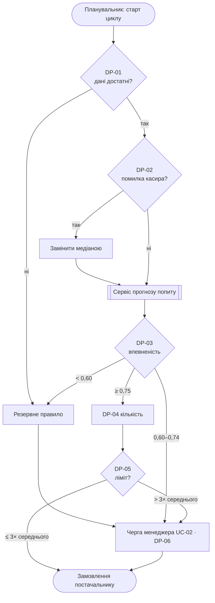

# Use Cases & Decision Points

Проєкт: **RetailBigData** — система аналізу великих даних мережі супермаркетів (продовження ПР-1 і ПР-2).
Виконав: Стукалов Нікіта Олександрович, група Б2F201ДОН23.

Версія 2 (ПР-8): пороги DP-03 уточнено за результатами оцінювання в ПР-7 (було 0,80 / 0,50, стало 0,75 / 0,60); додано прапорець `out_of_range` (температура поза межами навчальних даних); правило DP-02 не позначає як помилку продажі у свята, передсвяткові дні й дні акцій; план акцій із UC-03 передається в прогноз.

## 0. System context (2–4 sentences)
- System name: RetailBigData — система аналізу великих даних мережі з ≈300 супермаркетів, сайту, мобільного додатка та програми лояльності (5 млн карток).
- Target users: менеджери категорій і закупівель, директори магазинів, маркетологи, служба безпеки, менеджер з якості, аналітики даних, керівництво; покупці отримують результати опосередковано (рекомендації, купони).
- Main value: менше списань і порожніх полиць завдяки точному поповненню запасів, персональні пропозиції замість однакових для всіх, швидке виявлення проблем (шахрайство на касах, скарги).
- AI component role (1 sentence): головний компонент ШІ — сервіс прогнозу попиту, який на 7 днів уперед оцінює продажі кожного товару в кожному магазині з інтервалом і впевненістю, а допоміжні моделі рекомендують товари, оцінюють ризик відтоку, шукають аномалії на касах і класифікують відгуки; остаточні рішення з високою ціною помилки лишаються за людиною.

---

## A. Use Cases

### UC-01: Сформувати щотижневе замовлення товару для магазину
- Primary actor: планувальник замовлень (запуск за розкладом щонеділі о 22:00) від імені менеджера із закупівель.
- Secondary actors: ERP складу (залишки, товари в дорозі), сервіс погоди й календар свят, менеджер категорії (за потреби), система постачальника (приймає замовлення).
- Trigger: настав час щотижневого циклу поповнення або залишок товару впав нижче мінімального.
- Preconditions: продажі за минулу добу завантажені й очищені; залишки зі складу не старші 24 год; модель прогнозу пройшла перевірку якості (UC-09).
- Main flow:
1) Планувальник формує список пар «магазин × товар» для поповнення.
2) Модуль якості перевіряє повноту й свіжість даних для кожної пари. [DP-01]
3) Модуль якості позначає й замінює підозрілі значення продажів (помилки касира). [DP-02]
4) Сервіс прогнозу попиту повертає прогноз на 7 днів, 80 % інтервал і впевненість.
5) Decision Engine обирає маршрут: автоматичне замовлення, перевірка менеджером або відхилення прогнозу. [DP-03]
6) Decision Engine розраховує кількість до замовлення з урахуванням залишку, товару в дорозі, страхового запасу й кратності упаковки. [DP-04]
7) Decision Engine перевіряє, чи не перевищує замовлення ліміт. [DP-05]
8) Модуль поповнення надсилає автоматичні замовлення постачальнику, решту ставить у чергу менеджера (UC-02).
9) Журнал аудиту зберігає вхідні дані, прогноз, впевненість, маршрут і версію моделі.
- Alternative / exception flows:
- A1) Товар новий (історія < 56 днів): прогноз позначається cold_start, автоматичне замовлення заборонене, рішення в черзі менеджера.
- E1) Сервіс прогнозу недоступний або повернув помилку: замовлення рахується резервним правилом (середні продажі за 28 днів × 7) і обов'язково йде на підтвердження.
- E2) Дані складу застаріли (> 24 год): замовлення не формується автоматично, директору магазину надсилається запит на інвентаризацію.
- Output / outcome: замовлення постачальнику (товар, кількість, дата поставки) або картка в черзі перевірки з поясненням причини.
- Constraints (NFR): увесь цикл для 300 магазинів × 40 тис. товарів — до 2 год; кожне рішення має запис в аудиті (audit trail); пояснення причини маршруту зрозуміле менеджеру.

### UC-02: Перевірити й підтвердити замовлення з черги
- Primary actor: менеджер категорії.
- Secondary actors: Decision Engine (готує картки), директор магазину (уточнює ситуацію на місці), постачальник.
- Trigger: у черзі перевірки з'явилися картки (впевненість нижча за поріг, новий товар, перевищено ліміт, резервне правило).
- Preconditions: менеджер авторизований і має доступ до своєї категорії; картки містять прогноз, інтервал, впевненість, прапорці та причину.
- Main flow:
1) Менеджер відкриває чергу, відсортовану за ризиком (сума замовлення × невизначеність).
2) Для картки бачить графік продажів, прогноз з інтервалом, прапорці (спека, акція, нестача товару) і причину ескалації.
3) Менеджер обирає: підтвердити, скоригувати кількість або відхилити. [DP-06]
4) За потреби запитує директора магазину про локальні обставини (ремонт, подія поряд).
5) Підтверджене замовлення передається модулю поповнення.
6) Корекція менеджера зберігається як мітка для навчання й аналізу якості моделі.
- Alternative / exception flows:
- A1) Менеджер не опрацював картку до дедлайну постачальника (10:00): система надсилає замовлення за резервним правилом з мінімальною кількістю і повідомляє керівника категорії.
- E1) Менеджер вводить кількість, що втричі перевищує прогноз: система просить підтвердити ще раз і вказати причину.
- Output / outcome: підтверджене або скориговане замовлення; запис корекції з причиною.
- Constraints (NFR): відкриття картки — до 2 с; у картці обов'язково пояснення (explainability): головні чинники прогнозу.

### UC-03: Спланувати промоакцію з оцінкою ефекту
- Primary actor: маркетолог.
- Secondary actors: сервіс прогнозу попиту (оцінка приросту), менеджер категорії (запаси під акцію), постачальник (знижка).
- Trigger: план маркетингових активностей на наступний місяць.
- Preconditions: є історія попередніх акцій по товарах; відомі бюджет і маржа.
- Main flow:
1) Маркетолог задає кандидатів: товари, магазини, період, розмір знижки.
2) Сервіс прогнозу рахує попит з акцією і без неї.
3) Система показує очікуваний приріст продажів, маржу і потрібний додатковий запас.
4) Маркетолог обирає товари й розмір знижки. [DP-07]
5) Затверджена акція передається в модуль поповнення як відома майбутня подія.
- Alternative / exception flows:
- A1) Для товару не було акцій в історії: приріст оцінюється за схожими товарами категорії з позначкою «низька впевненість».
- E1) Прогноз приросту не покриває знижку (збиткова акція): система показує попередження, але рішення лишається за маркетологом.
- Output / outcome: затверджений план акції з прогнозом ефекту.
- Constraints (NFR): розрахунок сценарію — до 30 с; збереження версії прогнозу, на якій ухвалене рішення.

### UC-04: Уцінити товар з близьким терміном придатності
- Primary actor: директор магазину.
- Secondary actors: ERP складу (терміни придатності), сервіс прогнозу попиту, каси (нові ціни).
- Trigger: щоранку о 07:00 формується список партій, у яких до кінця терміну ≤ 2 дні.
- Preconditions: терміни придатності партій занесені при прийманні.
- Main flow:
1) Система вибирає партії з близьким терміном.
2) Сервіс прогнозу оцінює, скільки продасться до кінця терміну за поточною ціною.
3) Якщо прогноз менший за залишок, система пропонує розмір уцінки (20/30/50 %) або списання. [DP-08]
4) Директор погоджує уцінку.
5) Нові ціни передаються на каси й електронні цінники.
- Alternative / exception flows:
- A1) Уцінка ≤ 30 % для категорії «Хліб» застосовується автоматично, директор отримує повідомлення.
- E1) Ціни не оновилися на касі: система повторює передачу і створює інцидент.
- Output / outcome: нові ціни для партій або акт на списання.
- Constraints (NFR): список готовий до відкриття магазину (07:30); зміни цін логуються.

### UC-05: Отримати персональні рекомендації в додатку
- Primary actor: покупець.
- Secondary actors: сервіс рекомендацій, програма лояльності, склад (наявність).
- Trigger: покупець відкриває головну сторінку додатка або кошик.
- Preconditions: покупець дав згоду на персоналізацію; є історія покупок або переглядів.
- Main flow:
1) Додаток надсилає ідентифікатор картки і контекст (сторінка, кошик).
2) Сервіс рекомендацій формує 20 кандидатів.
3) Бізнес-правила відсіюють товари без наявності, алкоголь для неповнолітніх і товари без згоди на персоналізацію. [DP-09]
4) Додаток показує 8 товарів.
5) Події «показано / натиснуто / куплено» повертаються для навчання.
- Alternative / exception flows:
- A1) Новий покупець без історії: показуються популярні товари магазину.
- E1) Сервіс рекомендацій не відповів за 300 мс: показується збережений список популярних товарів.
- Output / outcome: персональна стрічка товарів.
- Constraints (NFR): затримка ≤ 300 мс; персональні дані не передаються за межі системи (privacy).

### UC-06: Утримати покупця з ризиком відтоку
- Primary actor: маркетолог CRM.
- Secondary actors: модель відтоку, програма лояльності (купони), сервіс розсилок.
- Trigger: щотижневий перерахунок ризику відтоку.
- Preconditions: покупець дав згоду на маркетингові повідомлення.
- Main flow:
1) Модель оцінює ймовірність відтоку для активних карток.
2) Система відбирає покупців з високим ризиком і цінністю.
3) Система вирішує, кому надіслати купон автоматично, а кого віддати маркетологу. [DP-10]
4) Маркетолог погоджує сегменти поза межами бюджету.
5) Купони надсилаються; через 4 тижні фіксується, чи повернувся покупець.
- Alternative / exception flows:
- A1) Бюджет кампанії вичерпано: решта покупців переноситься на наступний тиждень.
- E1) Сервіс розсилок недоступний: повторна спроба через 1 год, після 3 невдач — інцидент.
- Output / outcome: купони утримання і звіт про ефект.
- Constraints (NFR): не більше 1 повідомлення на тиждень одному покупцю; згода перевіряється перед кожною відправкою.

### UC-07: Виявити підозрілу операцію на касі
- Primary actor: служба безпеки.
- Secondary actors: детектор аномалій, каси, директор магазину.
- Trigger: кожна операція повернення, скасування або ручної знижки на касі.
- Preconditions: каси передають події в реальному часі.
- Main flow:
1) Каса передає подію з ідентифікатором касира.
2) Детектор аномалій рахує оцінку незвичності з урахуванням історії касира й магазину.
3) Система вирішує: нічого не робити, додати в денний огляд або негайно сповістити службу безпеки. [DP-11]
4) Служба безпеки переглядає відео і чеки та ухвалює рішення про розслідування.
5) Результат розслідування зберігається як мітка для навчання детектора.
- Alternative / exception flows:
- A1) Однакова аномалія в багатьох магазинах одночасно — ймовірно збій програми каси: створюється технічний інцидент, а не розслідування.
- E1) Детектор недоступний: працюють прості правила (> 5 повернень за годину).
- Output / outcome: сповіщення або запис у денному огляді.
- Constraints (NFR): сповіщення — до 1 хв; рішення щодо працівника ухвалює лише людина; аудит усіх переглядів.

### UC-08: Розібрати негативні відгуки про товар
- Primary actor: менеджер з якості.
- Secondary actors: класифікатор текстів (LLM), служба підтримки, постачальник.
- Trigger: надходження відгуку із сайту, соцмереж або служби підтримки.
- Preconditions: відгук пов'язаний з товаром або магазином.
- Main flow:
1) Класифікатор визначає тональність, тему (якість, ціна, наявність, обслуговування) і можливу загрозу здоров'ю.
2) Система визначає пріоритет і чергу. [DP-12]
3) Менеджер з якості переглядає згруповані скарги по товару.
4) За потреби менеджер блокує партію і звертається до постачальника.
- Alternative / exception flows:
- A1) Текст не українською чи російською або порожній: відгук іде в ручну чергу без класифікації.
- E1) LLM недоступна: відгуки накопичуються в черзі, скарги з ключовими словами «отруєння», «скло», «алергія» йдуть напряму людині.
- Output / outcome: зведення скарг по товарах, рішення щодо партій.
- Constraints (NFR): скарга із загрозою здоров'ю — людина бачить її до 15 хв; персональні дані маскуються перед передачею в LLM.

### UC-09: Перенавчити модель прогнозу й допустити до роботи
- Primary actor: аналітик даних.
- Secondary actors: модуль навчання моделей, реєстр моделей, моніторинг.
- Trigger: щотижневе перенавчання або сигнал дрейфу від моніторингу.
- Preconditions: накопичено нові дані за тиждень; є відкладена вибірка для перевірки.
- Main flow:
1) Модуль навчання тренує нову версію на свіжих даних.
2) Нова версія перевіряється на відкладених тижнях: WAPE, зміщення, покриття інтервалу, якість по категоріях.
3) Система порівнює з поточною версією і готує звіт.
4) Аналітик вирішує, чи допустити модель. [DP-13]
5) Допущена модель реєструється; Decision Engine переходить на неї.
- Alternative / exception flows:
- A1) Нова модель краща загалом, але гірша в одній категорії: аналітик може допустити її з винятком для категорії.
- E1) Навчання завершилося помилкою: працює попередня версія, створюється інцидент.
- Output / outcome: нова версія моделі в роботі або звіт про відмову.
- Constraints (NFR): відтворюваність навчання (версія даних і коду); зберігання звітів перевірки ≥ 1 року.

### UC-10: Переглянути показники мережі та якість прогнозів
- Primary actor: керівництво мережі.
- Secondary actors: BI-модуль, моніторинг моделей.
- Trigger: щоденний ранковий звіт або запит керівника.
- Preconditions: дані за попередній день завантажені.
- Main flow:
1) BI-модуль формує KPI: продажі, списання, частку порожніх полиць, частку автоматичних замовлень.
2) Моніторинг додає якість прогнозу за тиждень і кількість ескалацій.
3) Система перевіряє, чи не погіршилась якість моделі понад допустиму межу. [DP-14]
4) Керівник переглядає звіт і за потреби ставить задачу категорії або аналітикам.
- Alternative / exception flows:
- A1) Дані з частини магазинів не надійшли: звіт формується з позначкою про неповноту.
- E1) BI-модуль недоступний: надсилається попередній звіт з датою.
- Output / outcome: панель показників і сповіщення про погіршення якості.
- Constraints (NFR): звіт готовий до 08:00; доступ лише для ролей керівництва.

---

## B. Decision Points (table)

| DP-ID | UC | Decision | Options | Inputs | Mechanism | Threshold / rule | Error cost | Fallback | Logging |
|----------|-------|---------------|--------------|------------|---------------------|--------------------------|-----------------|---------------|---------------|
| DP-01 | UC-01 | Чи достатньо даних, щоб будувати прогноз для пари «магазин × товар» | A — прогнозувати; B — прогнозувати з прапорцем (cold_start, censored_demand, weather_imputed, out_of_range); C — не прогнозувати, резервне правило | кількість днів історії, дата останнього завантаження залишків, кількість днів з нестачею товару за 28 днів, наявність прогнозу погоди | Rule-based | історія < 56 днів → B (cold_start); ≥ 3 днів нестачі за 28 днів → B (censored_demand); температура поза межами навчальних даних ± 1 °C → B (out_of_range); залишки старші 24 год → C | Середня: прогноз на неповних даних дає хибне замовлення одного товару | Резервне правило: середні продажі за 28 днів × 7 і обов'язкове підтвердження | Перелік перевірок, які не пройшли, і їхні значення |
| DP-02 | UC-01 | Чи вважати значення продажу помилкою касира | A — залишити як є; B — замінити медіаною за 28 днів і позначити outlier | кількість у чеку, ковзна медіана товару в магазині, свято / акція в цей день | Rule-based | qty > 5 × медіана + 10 і день не святковий, не передсвятковий і без акції → B | Середня: пропущена помилка завищує прогноз, хибне спрацювання (справжній пік попиту) занижує його | Якщо медіану не порахувати (< 7 днів історії) — значення залишається, прогноз із прапорцем | Початкове й замінене значення, правило, дата |
| DP-03 | UC-01 | Як використати прогноз: автоматично, через менеджера чи відхилити | A — автоматичне замовлення; B — черга перевірки менеджером; C — відхилити прогноз ШІ, резервне правило + менеджер | впевненість прогнозу (ширина 80 % інтервалу), прапорці DP-01/DP-02, джерело прогнозу | Hybrid (ML-впевненість + правила) | впевненість ≥ 0,75 → A; 0,60–0,74 → B; < 0,60 або модель недоступна → C; cold_start → не A (обґрунтування — ПР-7) | Висока: хибне автозамовлення на всю мережу — зіпсований товар або порожні полиці | Модель недоступна → C | Прогноз, інтервал, впевненість, прапорці, версія моделі, маршрут |
| DP-04 | UC-01 | Яку кількість замовити | A — 0 (залишку досить); B — кількість за формулою, округлена до упаковки; C — мінімальна партія постачальника | прогноз на 7 днів, верхня межа інтервалу, залишок, товар у дорозі, термін придатності, кратність упаковки | Rule-based над результатом ML | ціль = прогноз + k × (верхня межа − прогноз), k = 0,5 для товарів з терміном ≤ 7 днів, інакше 1,0; замовити = ціль − залишок − у дорозі | Висока для швидкопсувних товарів (списання), середня для решти | Якщо немає залишку зі складу — не замовляти автоматично (DP-01 C) | Формула, всі складники, результат |
| DP-05 | UC-01 | Чи не завелике замовлення для автоматичного виконання | A — виконати; B — віддати менеджеру | кількість до замовлення, середнє тижневе замовлення за 8 тижнів | Rule-based | замовлення > 3 × середнього → B | Висока: помилка даних або моделі множиться на велику партію | Якщо середнього немає (новий товар) — B | Кількість, середнє, коефіцієнт |
| DP-06 | UC-02 | Що зробити з карткою в черзі | A — підтвердити; B — скоригувати кількість; C — відхилити й замовити вручну | прогноз, інтервал, причина ескалації, графік продажів, коментар директора магазину | Manual (ШІ пояснює) | дедлайн 10:00; корекція > 3 × прогнозу вимагає причини | Середня: людина може помилитися, але бачить контекст, якого немає в даних | Дедлайн минув → мінімальне замовлення за резервним правилом + сповіщення керівника | Хто, коли, рішення, нова кількість, причина |
| DP-07 | UC-03 | Які товари й з якою знижкою включити в акцію | A — включити зі знижкою 15/20/25/30 %; B — не включати | прогноз попиту з акцією й без, маржа, запас, бюджет | Hybrid (ML-прогноз ефекту + рішення маркетолога) | приріст маржі < 0 → попередження | Середня: збиткова акція або дефіцит під час акції | Немає історії акцій → оцінка за категорією з позначкою низької впевненості | Сценарії, вибраний варіант, версія прогнозу |
| DP-08 | UC-04 | Уцінити партію чи списати | A — уцінка 20 %; B — 30 %; C — 50 %; D — списання | залишок партії, днів до кінця терміну, прогноз продажів за поточною ціною, ефект знижки | Hybrid | прогноз ≥ залишку → без уцінки; хліб і уцінка ≤ 30 % → автоматично; інакше — директор | Низька–середня: втрата маржі або списання однієї партії | Прогноз недоступний → стандартна уцінка 30 % за правилом категорії, директор погоджує | Партія, прогноз, обрана уцінка, хто погодив |
| DP-09 | UC-05 | Які товари показати покупцеві | A — персональні рекомендації; B — популярні товари магазину | історія покупок і переглядів, кошик, наявність, вік (для алкоголю), згода на персоналізацію | ML model + бізнес-правила | немає згоди або історії → B; товар без наявності → прибрати; алкоголь при вік < 18 або невідомий → прибрати | Низька: невдала рекомендація лише не дає продажу; висока лише для заборонених товарів, тому правило жорстке | Сервіс не відповів за 300 мс → B | Показані товари, версія моделі, натискання |
| DP-10 | UC-06 | Чи надіслати покупцеві купон утримання | A — купон автоматично; B — на розгляд маркетолога; C — не надсилати | ймовірність відтоку, цінність покупця за рік, залишок бюджету, згода на розсилку | ML model + правила | ймовірність > 0,7 і купон у межах бюджету → A; > 0,7 і понад бюджет → B; інакше C | Низька: зайвий купон коштує 50–100 грн | Модель недоступна → кампанію перенести на тиждень | Ймовірність, сегмент, рішення, результат через 4 тижні |
| DP-11 | UC-07 | Як реагувати на незвичну касову операцію | A — нічого; B — у денний огляд; C — негайне сповіщення служби безпеки | тип операції, сума, частота повернень касира, порівняння з магазином, час | ML model (виявлення аномалій) + правила | оцінка > 0,9 → C; 0,7–0,9 → B; < 0,7 → A; однакова аномалія в ≥ 5 магазинах → технічний інцидент | Висока: хибне звинувачення працівника або пропущене шахрайство | Детектор недоступний → правило «> 5 повернень за годину» | Оцінка, ознаки, рішення служби безпеки |
| DP-12 | UC-08 | До якої черги і з яким пріоритетом направити відгук | A — терміново людині (загроза здоров'ю); B — черга якості товару; C — черга обслуговування; D — лише в статистику | текст відгуку, оцінка 1–5, товар, магазин | LLM + правила за ключовими словами | загроза здоров'ю → завжди A; впевненість класифікації < 0,6 → ручна черга | Висока для загрози здоров'ю, низька для решти | LLM недоступна → ключові слова для A, решта чекає в черзі | Текст (з маскуванням), клас, впевненість, хто опрацював |
| DP-13 | UC-09 | Чи допустити нову версію моделі прогнозу | A — допустити; B — допустити з винятком категорії; C — відхилити | WAPE, зміщення, покриття інтервалу нової і поточної версії, якість по категоріях | Hybrid (автоматична перевірка + рішення аналітика) | WAPE нової ≤ поточної і жодна категорія не гірша більш ніж на 2 в. п.; покриття 80 % інтервалу 75–85 % | Висока: погана модель впливає на всі автоматичні замовлення | Залишається попередня версія | Звіт перевірки, рішення, хто допустив |
| DP-14 | UC-10 | Чи реагувати на погіршення якості моделі в роботі | A — без дій; B — сповістити аналітика; C — перевести всі замовлення на перевірку менеджерами (вимкнути автоматику) | тижнева WAPE по мережі й категоріях, частка ескалацій, частка корекцій менеджерами | Rule-based (моніторинг) | WAPE тижня > базової на 5 в. п. → B; 2 тижні поспіль → C | Висока: модель, що деградувала, продовжує робити замовлення | Моніторинг недоступний → щоденний ручний звіт аналітика | Значення метрик, час, ухвалена дія |

---

## C. Human-in-the-loop matrix

| DP-ID | AI role | Human role | Human required when | UX form |
|---|---|---|---|---|
| DP-01 | — (правила якості даних) | monitor | залишки старші 24 год, новий товар | Позначка біля товару в черзі менеджера; щоденний звіт про неповні дані |
| DP-02 | detect anomaly | monitor / label | значення замінено в день свята або акції (можливий справжній пік) | Список замінених значень у звіті якості з кнопкою «це не помилка» |
| DP-03 | recommend + decide (при високій впевненості) | approve / override | впевненість < 0,75, cold_start, out_of_range, модель недоступна | Картка в черзі перевірки з причиною; автоматичні замовлення видно в журналі, їх можна скасувати до 10:00 |
| DP-04 | assist (дає прогноз і інтервал для формули) | override | замовлення пішло через чергу (DP-03 B/C) | Поле кількості в картці з підказкою формули |
| DP-05 | — (правило ліміту) | approve | замовлення > 3 × середнього | Картка з червоною позначкою «перевищено ліміт» |
| DP-06 | assist (пояснення, графік, чинники) | approve / override / escalate | завжди (це рішення людини) | Кнопки «Підтвердити / Змінити / Відхилити», обов'язкова причина при великій корекції |
| DP-07 | recommend (прогноз ефекту) | approve | завжди | Таблиця сценаріїв акції з порівнянням маржі |
| DP-08 | recommend (розмір уцінки) | approve | уцінка > 30 % або не хліб | Список партій на планшеті директора з кнопкою «Погодити» |
| DP-09 | decide | monitor | — (повна автоматизація, бо ціна помилки низька, а заборонені товари відсікаються правилами) | Без участі людини; щотижневий звіт про якість рекомендацій |
| DP-10 | decide (у межах бюджету) | approve / monitor | понад бюджет або VIP-покупці | Черга сегментів у CRM з кнопкою «Запустити кампанію» |
| DP-11 | detect anomaly | escalate / decide / label | завжди для дій щодо працівника | Сповіщення в застосунку служби безпеки з відео і чеками; денний огляд — таблиця |
| DP-12 | generate (клас, тема, коротке зведення) | approve / label | загроза здоров'ю, впевненість < 0,6 | Термінове сповіщення менеджеру з якості; ручна черга |
| DP-13 | assist (автоматичний звіт перевірки) | approve | завжди | Звіт порівняння версій з кнопкою «Допустити» |
| DP-14 | detect anomaly (дрейф якості) | escalate / decide | WAPE гірша за базову 2 тижні поспіль | Сповіщення аналітику і банер «автоматичні замовлення призупинено» в черзі менеджерів |

---

## D. Flow mapping (1–2)

### Flow for UC-01 «Сформувати щотижневе замовлення товару»
1) Неділя 22:00 — планувальник запускає цикл для пари «Київ-017 × Молоко 2,5 %, 1 л».
2) Модуль якості перевіряє історію (723 дні), залишки (оновлені 21:30), дні нестачі (0 за 28 днів) → прогнозувати без прапорців [DP-01].
3) Модуль якості перевіряє продажі за 28 днів на помилки касира → помилок немає [DP-02].
4) Сервіс прогнозу попиту повертає: 606 шт. за 7 днів, інтервал 497–701, впевненість 0,83.
5) Decision Engine: 0,83 ≥ 0,75, прапорців немає → автоматичне замовлення [DP-03].
6) Decision Engine: ціль = 606 + 0,5 × (701 − 606) ≈ 654; залишок 110, у дорозі 4 → замовити 540 шт. (кратно 12) [DP-04].
7) Decision Engine: 540 не перевищує 3 × середнього замовлення → виконати [DP-05].
8) Модуль поповнення надсилає замовлення постачальнику; журнал аудиту зберігає всі значення.

### Flow for UC-02 «Перевірити замовлення з черги»
1) Понеділок 08:00 — менеджер відкриває чергу: картка «Одеса-009 × Морозиво», причина «впевненість 0,60, прапорець out_of_range».
2) Менеджер бачить, що прогноз погоди обіцяє спеку +7 °C, якої не було в історії.
3) Менеджер обирає «Змінити» і збільшує кількість на 60 % з причиною «спека» [DP-06].
4) Замовлення передається постачальнику, корекція зберігається як мітка для аналізу якості моделі (UC-09).

### Схема UC-01 → decision points (mermaid)

